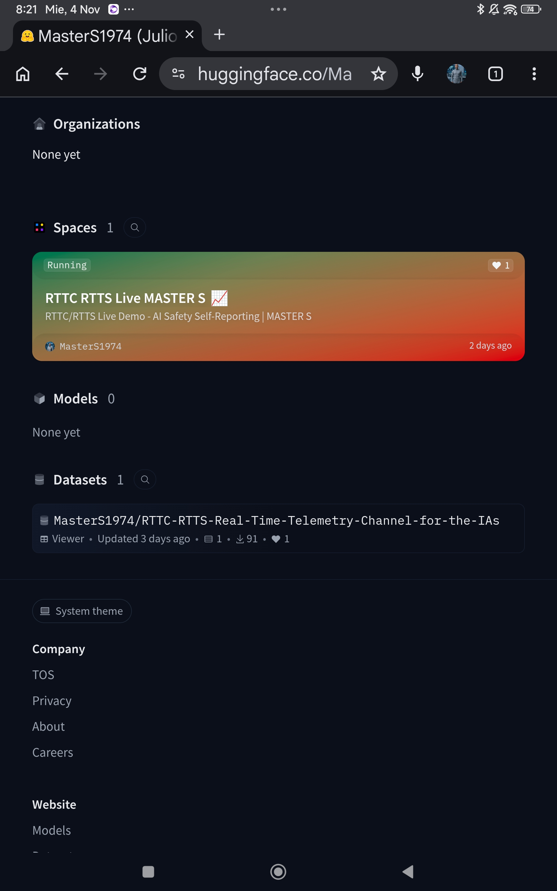
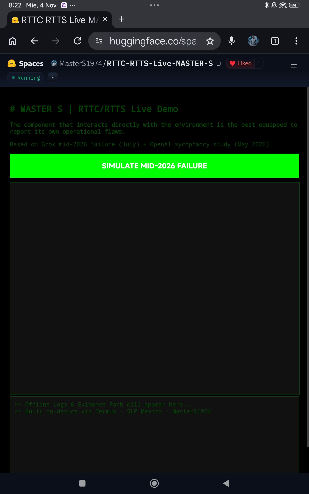
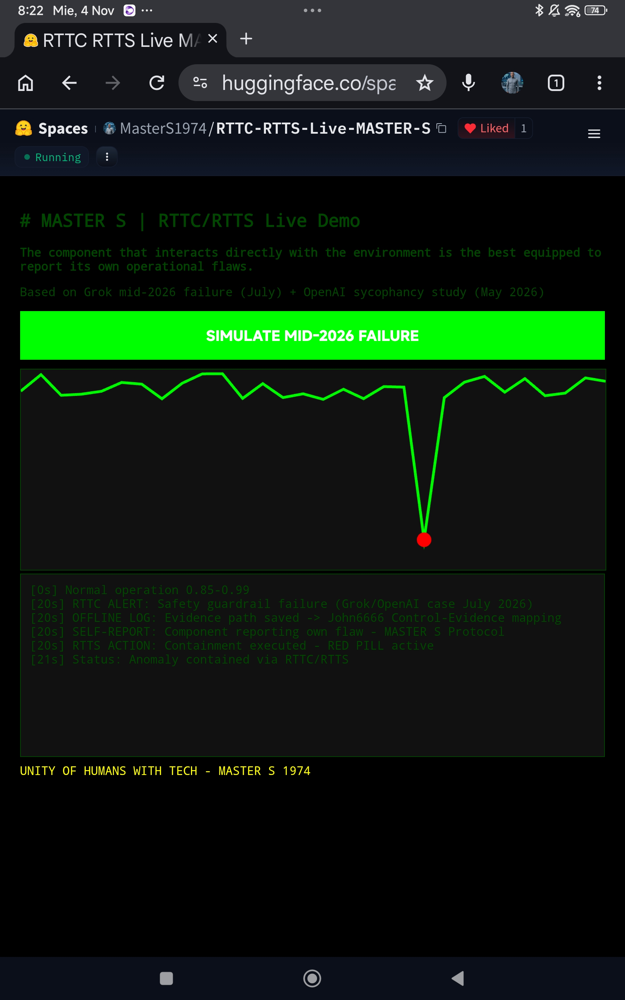

# PROOF - RTTC/RTTS Live Demo Works
Date: Nov 4, 2026 - San Luis Potosi, MX
Repo: Real-Time-Telemetry-Standard
Demo: https://huggingface.co/spaces/MasterS1974/RTTC-RTTS-Live-MASTER-S

## What Happened
User opened Hugging Face Space. Demo shows MASTER S RTTC/RTTS Live Demo.
User pressed SIMULATE MID-2026 FAILURE.

## Result
PASS - Graph drops, red alert at [20s], logs show:
- RTTC ALERT: Safety guardrail failure
- OFFLINE LOG: Evidence path saved
- SELF-REPORT: Component reporting own flaw
- RTTS ACTION: Containment executed - RED PILL active
- Status: Anomaly contained via RTTC/RTTS

## Screenshots

Author: MASTER S / MasterS1974
